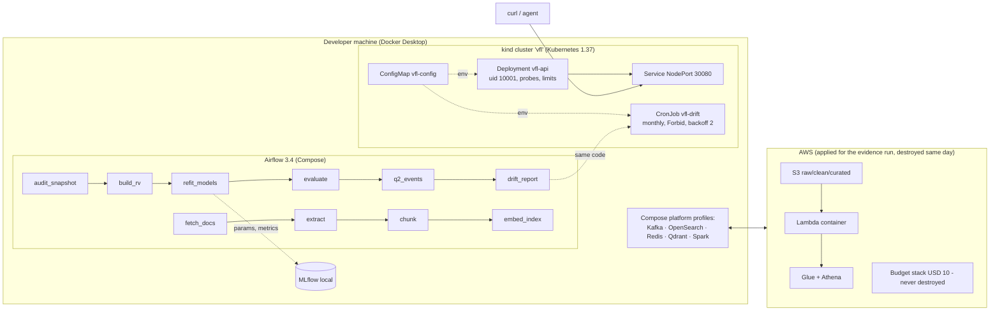

# Architecture — vol-forecast-lab

A pre-registered realised-volatility forecasting study with the data and AI platform around it:
a document pipeline over FOMC text, a re-platformed version on Kafka, AWS, Spark, OpenSearch and
Redis, a research agent that can only repeat computed numbers, MLOps, an Airflow DAG and a local
Kubernetes deployment. Research prototype on public data; not investment advice; not a trading system.

Decisions and their trade-offs: [`docs/adr/`](docs/adr/README.md). What each claim rests on:
[`EVIDENCE.md`](EVIDENCE.md).

## 1. System context

| Actor / system | Role |
|---|---|
| Market data (Tiingo SPY OHLC, Cboe VIX; FRED VIXCLS cross-check) | Inputs to the forecasting study, pinned in a hashed snapshot |
| Federal Reserve website | FOMC statements (HTML) and minutes (PDF) for the document pipeline |
| OpenAI API | Embeddings (text-embedding-3-small) and the agent's pinned chat model |
| LangSmith | Agent traces |
| AWS (one account, one region) | Serverless data lake for the 10c evidence run; destroyed the same day |
| User / analyst | Reads FINDINGS and the dashboard; calls the read-only API; asks the agent |

## 2. Layers

| Layer | Components | Code |
|---|---|---|
| Data and audit | Snapshot + SHA-256 manifest, audit, event calendars (FOMC, CPI, unscheduled) | `scripts/fetch_data.py`, `audit_snapshot.py`, `data/` |
| Research core | RV proxies and 30-day targets; walk-forward splitter; M0 persistence, M1 HAR, M2 HAR-X, M3 GARCH(1,1), M4 MLP; Clark–West, Diebold–Mariano, Mincer–Zarnowitz, Holm; Q2 spread/premium; Q3 event regressions | `src/volab/` |
| Document pipeline (10b) | fetch → extract → chunk → DQ → embed + index (Qdrant) → evaluate | `src/volab/text/` |
| Platform slice (10c) | Kafka (`docs.raw`, `docs.clean`, `docs.dlq`); S3 + Lambda + Glue + Athena (Terraform); PySpark compaction; OpenSearch BM25 + RRF; Redis cache + limiter | `infra/`, `lambda/`, `spark/`, `docker-compose.platform.yml` |
| Serving | FastAPI: `/search`, `/forecast`, `/compare`, `/health`, `/metrics` | `api/app.py` |
| Agent | LangGraph: parse → route → tools → compose → verify (copy-only) → answer or refuse | `agent/` |
| MLOps | MLflow tracking, snapshot ID stamped on every results table, drift report, Dockerfile, CI | `src/volab/drift.py`, `scripts/run_drift.py`, `.github/workflows/ci.yml` |
| Orchestration and runtime | Airflow DAG `vol_pipeline`; kind cluster with API Deployment, drift CronJob, ConfigMap | `dags/`, `k8s/`, `scripts/kind_up.ps1` |

## 3. Diagrams

- Research pipeline: [`figures/diagrams/overall.svg`](figures/diagrams/overall.svg)
- Document pipeline (10b): [`figures/diagrams/step10b.svg`](figures/diagrams/step10b.svg)
- Platform slice (10c): [`figures/diagrams/step10c.svg`](figures/diagrams/step10c.svg), [`platform.svg`](figures/diagrams/platform.svg)
- Agent graph: `BUILD_GUIDE.md` → Architecture (second diagram)
- Deployment (below; source `docs/diagrams/deployment.mmd`)

## 4. Key data flows

1. **Forecasting.** Snapshot → audit (fails the DAG on a hash mismatch) → RV targets → expanding
   walk-forward, refit every 21 sessions → forecasts → losses and tests → `results/*.parquet` with the
   snapshot ID. 1,703 test forecasts, 2020-01-02 → 2026-10-12.
2. **Documents, local.** 134 statements + 132 minutes → `documents.parquet` (fixed schema) →
   6,620 chunks → Qdrant (dense + keyword, contextual header) → 15-question eval.
3. **Documents, platform.** Producer → Kafka `docs.raw` → uploader → S3 `raw/` → Lambda → `clean/`
   Parquet partitioned by year/doc_type → Athena; `docs.clean` → indexer → OpenSearch + Qdrant →
   RRF in the API, behind the Redis cache and limiter. Parity gates: text 266/266, chunks 6,620.
4. **Agent.** Question → structured intent → tool over `results/` → structured draft → verifier
   (every number must appear in a tool output) → answer, one retry, or refusal.
5. **Monitoring.** Month-end PSI (trailing 126 sessions) and QLIKE ratio M2/M1 (63 sessions) →
   `drift_report.parquet` + `drift_summary.json`; the same code runs as the kind CronJob.

## 5. Controls

| Concern | Control | Where |
|---|---|---|
| Specification search | Pre-registration tag before any fit; eval sets frozen before first run; deviations log | `prereg/`, ADR 0001 |
| Leakage | No target overlap across the train/forecast boundary; planted-leak check on the real panel | `splits.py`, FINDINGS Step 7 |
| Reproducibility | Hashed snapshot; pinned packages and images; snapshot ID in outputs; MLflow runs | ADR 0003 |
| Licence | No row-level market data in git, FINDINGS or the dashboard (test-enforced on the dashboard) | `tests/test_build_dashboard.py` |
| Idempotence | Upserts keyed by content hash; Kafka dedupe on (doc_id, sha256); reload idempotence checks | ADRs 0004–0005 |
| Cost | Budget stack applied first and kept; Athena scan cutoff; same-day destroy; agent cost cap USD 0.50 per run | ADRs 0006–0007 |
| Least privilege | Lambda role scoped to prefixes and its log group; build user scoped to one ECR repo | `infra/terraform/` |
| Hallucinated numbers | Copy-only verifier; advice and out-of-range refusals | ADR 0007 |
| Runtime hardening | Non-root uid 10001, no privilege escalation, probes, limits, Forbid concurrency, no secrets in manifests | `k8s/`, ADR 0009 |
| Secrets | `.env` (git-ignored, history check before every push); Airflow Variables; Terraform tfvars git-ignored | — |
| CI | Python 3.12 + 3.14 tests, ruff, Terraform fmt/validate, Docker build, DAG import, kubeconform | `.github/workflows/ci.yml` |

## 6. Boundaries

- Local orchestration and a local cluster; not a production deployment. The full snapshot DAG run
  (`use_snapshot=true`) has not been executed.
- AWS resources existed only for the 16 Nov 2026 evidence run.
- Daily data: event effects cover the whole session, not the announcement window.
- Retrieval and agent evals are small (15 questions each): directional evidence, not benchmarks.
- A clean clone reproduces the pipeline on the synthetic fixture; the headline numbers need the
  user's own data access and the same snapshot.
