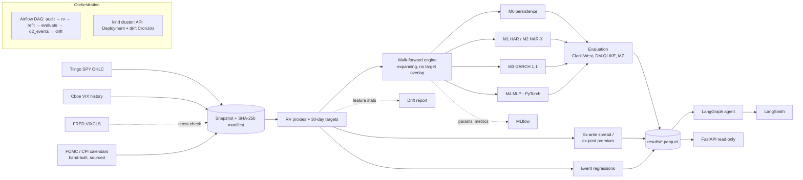
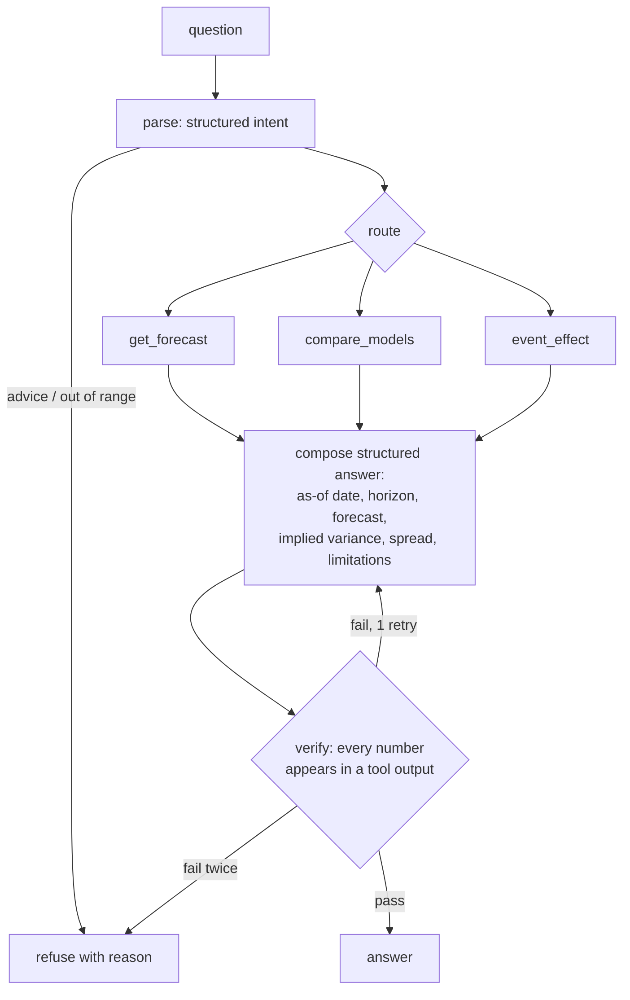
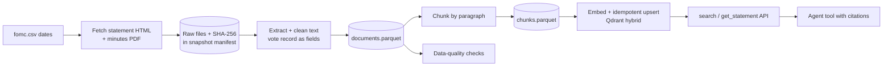
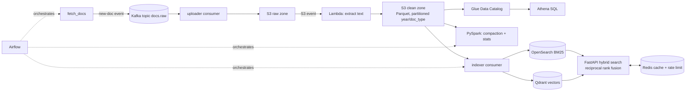

# vol-forecast-lab — build guide (S1)

**Date started:** _YYYY-MM-DD_
**Starting point:** empty repo. Reused: the snapshot-and-hash data discipline and the
pre-registration / deviations pattern from `tsmom-panel-study`.
**Goal:** a research tool that answers three pre-registered questions on S&P 500 ETF daily data —
(1) does VIX-implied variance improve out-of-sample forecasts of the next 30 days' realised
variance beyond HAR (with GARCH, a persistence baseline and a small MLP as comparators);
(2) how implied variance compares with the forecast (estimated ex-ante spread) and with what
followed (ex-post premium); (3) whether scheduled CPI and FOMC days carry extra variance, overnight
or in the session — delivered as a reproducible pipeline with experiment tracking, data versioning,
drift monitoring, Docker, CI, an Airflow DAG, a local Kubernetes deployment, an unstructured-data
pipeline (FOMC statements and minutes → Parquet → vector index), and a tool-calling agent that only
reports computed numbers and cited text.
**Labels:** public data; research prototype; not investment advice. Not a trading system.

**Authorship rule.** The author hand-writes the core: RV proxies, targets, splitter, HAR/HAR-X,
losses and tests (Clark–West, Diebold–Mariano, Mincer–Zarnowitz), event regressions, the MLP,
the agent graph and verifier, the DAG task graph, the Kubernetes manifests, drift metrics and every
test of author-written code. Tests of AI-written plumbing (fetch, compose, API routing, Terraform
naming) may be AI-written; they are reviewed line by line and listed under Issues and fixes.
AI assistance is limited to plumbing (data fetch, Docker/Compose files, CI workflow, FastAPI
wrapper, README formatting), reviewed line by line. Each step says which applies.

**Build order (vertical slice first).** Lock data and pre-registration → persistence/HAR/HAR-X
with evaluation → GARCH and the event study → MLP and agent → MLOps, Airflow and Kubernetes →
write-up. Step 10b (unstructured-data pipeline) comes after the MLP and before the agent.
Step 10c (Kafka, AWS serverless data lake, Spark, OpenSearch, Redis) follows 10b.
JAX is a stretch item after everything else. Hours are ESTIMATES (~52 h core).

---

## Architecture





---

## Repository layout

```
vol-forecast-lab/
  README.md  BUILD_GUIDE.md  FINDINGS.md  CASE_STUDY.md  LICENSE
  prereg/PREREGISTRATION.md  prereg/DEVIATIONS.md
  data/SOURCES.md  data/snapshot_manifest.json  data/audit.json
  data/events/fomc.csv  data/events/cpi.csv  data/events/unscheduled.csv
  data/raw/  data/snapshots/                 # git-ignored
  src/volab/ data.py  calendar.py  rv.py  targets.py  splits.py  losses.py  stats_tests.py
             models/{baselines,har,garch,mlp}.py  spread.py  events.py  drift.py
             text/{fetch_docs,extract,chunk,index,dq}.py
  docker-compose.qdrant.yml  docker-compose.platform.yml   # profiles: kafka, search, cache
  infra/terraform/   lambda/extract/   spark/
  agent/ graph.py  tools.py  schemas.py  eval_questions.yaml  run_eval.py
  api/app.py   dags/vol_pipeline.py   k8s/   docker-compose.airflow.yml
  scripts/ fetch_data.py  audit_snapshot.py  run_all.py
  tests/  fixtures/   results/  figures/
  Dockerfile  .github/workflows/ci.yml  requirements.txt  .gitignore  .env.example
```

---

## Step 0 — Repo and environment (0.5 h)

**What.** Repo, `.venv`, pinned `requirements.txt` (pandas, numpy, scipy, statsmodels, arch, torch,
exchange-calendars, pyarrow, mlflow, langgraph, langchain-openai, langsmith, pydantic, fastapi,
uvicorn, pytest). `.gitignore`: `.env`, `.venv`, `data/raw`, `data/snapshots`, `mlruns`, `*.db`.
MIT licence. `prereg/DEVIATIONS.md` header.
**Who.** AI-drafted plumbing, reviewed.
**Result.** `python -m pytest` runs. Actual: _fill_.
**Committed.** _hash_

## Step 1 — Data pull, snapshot, audit (2 h)

**What.** `fetch_data.py` pulls SPY adjusted OHLC and VIX once into `data/snapshots/<id>/`, hashes
each file, writes the manifest, never overwrites. `audit_snapshot.py` runs PREREGISTRATION §2.4
and writes `data/audit.json`, including the list of dates excluded under §2.3 (no forward-fill).
**Who.** Fetch = AI-drafted. Audit rules = author.
**Result.** _sessions, violations, VIX mismatches, excluded dates_.
**Committed.** _hash_

## Step 2 — Event calendars (1 h)

**What.** `fomc.csv`, `cpi.csv`, `unscheduled.csv`: `date, time_et, type, source_url`.
**Who.** Author (Gemini may draft the list; every row checked against its source page).
**Tests.** Every date is a session; every row has a URL; CPI rows are 08:30 ET; FOMC rows fall
inside the regular session; same-day CPI+FOMC dates listed.
**Committed.** _hash_

## Step 3 — RV proxies and 30-day targets (2 h)

**What.** `rv.py`: `overnight`, `session_return`, `garman_klass`, `parkinson`, `rv_primary`,
`cross_term`. `targets.py`: `target_30d(rv, sessions, t)` and `n_sessions(t)` per §3.2.
**Who.** Author.
**Tests (hand-computed).**

| Case | Inputs | Expected |
|---|---|---|
| Day 1, no gap | C_prev 100, O 100, H 102, L 99, C 101 | r_on = 0; GK = 0.000407353; RV = 0.000407353 |
| Day 2, gap up | C_prev 101, O 101.5, H 102, L 100.5, C 100.8 | r_on² = 0.0000243866; GK = 0.0000912428; RV = 0.000115629 |
| Parkinson, day 1 | H 102, L 99 | 0.000321432 |
| 30-day window | t = 2 Jan; sessions 30 Jan, 1 Feb, 2 Feb | includes 30 Jan and 1 Feb (= t + 30 days); excludes 2 Feb; N_t = 2 |
| Excluded session inside window | one session flagged missing | target dropped, logged |
| Zero-range day | O=H=L=C | GK = 0, not NaN |

**Committed.** _hash_

## Step 4 — Freeze the pre-registration (1 h)

**What.** Fill every placeholder (hashes, counts, seeds, versions, audit table, F_min, regime
thresholds — the last two from the training window only). Commit, `git tag v0.1-prereg`, push the
tag. Optional OSF registration.
**Rule.** No model fitted and no test-period number looked at before this commit.
**Committed.** _hash_ / tag _hash_

## Step 5 — Walk-forward splitter (1.5 h)

**What.** `splits.py`: expanding windows, refit every 21 sessions, and the rule that the last
training target ends before the forecast date.
**Who.** Author.
**Tests.** No training target overlaps a forecast date; windows never shrink; first forecast =
first session ≥ test start; validation folds stay inside 2016-01-01 → 2019-12-31, and validation is
used only to select M4 — M1–M3 are fixed-form, with nothing tuned on it. (Test-period training sets
do include 2016–19 rows: that is the expanding window of §5.2, not leakage.)
**Committed.** `c13de96`

## Step 6 — Vertical slice: M0, HAR, HAR-X (2 h)

**What.** `baselines.py` (M0; R1 implied), `har.py` (OLS with `numpy.linalg.lstsq`; M2 adds
IV_t/N_t); per-session forecasts × N_t; positivity rule §3.4 with floor counts.
**Who.** Author.
**Tests.** HAR recovers β = [0.1, 0.4, 0.3, 0.2] to 1e-8 on noise-free synthetic data; IV for
VIX = 20 equals 0.00328767; HAR-X with a zero IV coefficient reproduces HAR exactly.
**Committed.** `3522c47`

## Step 7 — Evaluation (3 h)

**What.** `losses.py` (QLIKE, MSE); `stats_tests.py`: Clark–West, Diebold–Mariano, Mincer–Zarnowitz,
Newey–West HAC, Holm. Run M0/M1/M2 end to end on the test period; write `results/*.parquet`.
This completes the slice: data → targets → models → Q1 result.
**Who.** Author. Cross-check: DM t-stat equals statsmodels OLS of d_t on a constant with
`cov_type="HAC"` and the same lag (to 1e-6).
**Tests.** QLIKE(RV = F) = 0; QLIKE(RV = 2F) = 0.306853; QLIKE(RV = F/2) = 0.193147;
DM and Clark–West on identical forecasts → statistic 0; planted-leak test (§9.1) shows a sharp drop.
**Committed.** `7775f9d` (code) / `0097ca6` (results)

## Step 8 — GARCH(1,1) (1.5 h)

**What.** `garch.py`: `arch` normal QMLE on % returns; sum N_t step-ahead variances; ÷ 10,000.
**Tests.** Unit conversion; forecast positive; α + β logged per fold (arch caps it at 1; folds at the bound counted).
**Who.** Author.
**Committed.** `9eb2155` (code) / `5008c38` (results)

## Step 9 — Spread, premium and event study (3 h)

**What.** `spread.py`: ex-ante spread (IV − HAR forecast) and ex-post premium (IV − realised),
summaries by year and regime. `events.py`: the §7.3 regressions per component, §7.4 VIX-change
regression, Holm, counts and CIs, robustness runs.
**Who.** Author.
**Tests.** Regression recovers a planted event effect on a synthetic series; an event date off the
calendar raises; same-day CPI+FOMC sets both indicators.
**Committed.** `5168a0b` (code) / `e4377f3` (results)

## Step 10 — MLP challenger (3 h)

**What.** `mlp.py` per PREREGISTRATION §4.3: scaler fitted on training rows only, three seeds,
validation-only selection, annual re-train, results reported whatever they show.
**Tests.** Scaler uses training rows only (assert); fixed seed → identical output; shuffled-target
MLP loses to M0.
**Committed.** `72ca52d` / `0c35af5` (code) / `eb8bb23` (selection) / `4983d5f` (results)

## Step 10b — Unstructured-data pipeline: FOMC statements and minutes (6 h)

**What.** A small production-style pipeline from public Federal Reserve documents to a searchable
vector index, keyed by `data/events/fomc.csv`.



| Stage | Detail | Who |
|---|---|---|
| Fetch | One statement page and one minutes PDF per scheduled date; rate-limited, user-agent set; raw files cached in the snapshot with hashes; incremental (new dates only) | AI plumbing |
| Extract | HTML → statement text; PDF → text with PyMuPDF, headers/footers stripped, page numbers kept; unicode/whitespace normalised; voting record split into fields (for, against, dissent reasons) | Author |
| Store | `documents.parquet`: doc_id, event_date, doc_type, url, sha256, text, n_chars, page_count, extractor_version, extracted_at — fixed pyarrow schema | Author |
| Chunk | Paragraph-based, ~300-token cap; `chunks.parquet`: chunk_id, doc_id, ord, page, text, n_tokens | Author |
| Embed + index | OpenAI small embedding model; Qdrant (Docker) with dense + keyword (hybrid) retrieval and payload filters (date, doc_type); upsert keyed by chunk_id + content hash | Author: upsert logic. AI: Qdrant compose file |
| Serve | `search(query, date_from, date_to, doc_type, k)`, `get_statement(date)` on the FastAPI app; agent tool returns text with URL + chunk_id citations | AI: routes. Author: agent tool |
| Evaluate | 15 retrieval questions with answers and supporting chunks labelled **before** the first run; recall@5 and MRR, reported per doc type | Author |
| Orchestrate | Airflow tasks `fetch_docs → extract → chunk → embed_index`, incremental and safe to re-run; added to the Step 13 DAG | Author |
| Data quality | Exactly one statement per scheduled date; minutes present for every meeting with released minutes; empty/short texts flagged; hash change → re-extract and re-index | Author |

**Why.** Text extraction, document parsing, Parquet storage, vector search, idempotent incremental
loads and retrieval evaluation — the unstructured-data side of the pipeline, end to end.
**Scope boundary.** Engineering only: no sentiment scores, text features or signals. Statements are
used for retrieval and explanation beside the event-study results, never as model inputs.
**Tests.** Extraction on two committed fixture pages (US Government works, public domain) and one
fixture PDF; chunk boundaries; two consecutive runs leave the same point count; date filters never
return out-of-range chunks; parquet schema test.
**Result.** Docs _n_ statements / _n_ minutes; chunks _n_; recall@5 _x_; MRR _x_; DQ flags _n_.
**Committed.** _hash_

## Step 10c — Platform slice: Kafka, AWS serverless data lake, Spark, OpenSearch, Redis (11 h)

**What.** The Step 10b document pipeline re-platformed onto the stack a production data platform
uses. Same documents, same outputs, so every new component can be checked against Step 10b.



| Part | Detail | Who | Hours |
|---|---|---|---|
| 10c-1 Kafka (local, KRaft, Docker) | Topics `docs.raw`, `docs.clean`; producer in `fetch_docs`; consumers `uploader` and `indexer` with consumer groups; at-least-once delivery, idempotent handling by doc hash; dead-letter topic for failures | Author: producer/consumer logic, idempotency. AI: compose file | 2 |
| 10c-2 AWS serverless data lake | Terraform: S3 bucket with `raw/`, `clean/`, `curated/` prefixes (versioning, encryption, block public access, lifecycle), Lambda (Python) on S3 put → extract text → partitioned Parquet in `clean/`, Glue database + table, Athena workgroup with a result bucket and bytes-scanned limit; least-privilege IAM role; CloudWatch logs; budget alert set first; `terraform destroy` documented and tested | Author: Lambda handler, Athena queries, IAM policy review. AI: Terraform skeleton, reviewed line by line | 4.5 |
| 10c-3 PySpark (local) | Read `clean/` Parquet, compact small files, compute per-year/doc-type statistics, write `curated/`; schema enforced; result matches the pandas version | Author | 1.5 |
| 10c-4 OpenSearch (local, Docker) | Index with an explicit mapping (text, keyword, date); BM25 search with date/doc-type filters; hybrid with Qdrant via reciprocal rank fusion; Step 10b retrieval eval rerun: BM25 only / vectors only / fused, reported side by side | Author | 2 |
| 10c-5 Redis (local, Docker) | Cache for `search` responses (key = normalised query + filters hash, TTL), hit/miss counters exposed on `/metrics`; token-bucket rate limiter on the API | Author | 1 |

**Tests.** Kafka: replaying the same message twice indexes once. Lambda: handler unit-tested with a
fixture S3 event (no AWS in CI). Terraform: `terraform validate` and `fmt -check` in CI. Spark vs
pandas statistics equal. OpenSearch: date filter respected; mapping applied. Redis: second identical
query is a cache hit; rate limiter rejects over the limit.
**Cost guardrails.** Budget alert before `terraform apply`; Athena bytes-scanned limit; S3 lifecycle;
everything destroyed after the evidence run, with the destroy output saved in FINDINGS.
**Result.** Kafka messages processed _n_ / duplicates suppressed _n_; Lambda runs _n_ / errors _n_;
Athena query cost _$x_; recall@5 BM25 / vector / fused _x / x / x_; cache hit rate _x_.
**Committed.** _hash_

## Step 11 — Research agent: LangGraph + LangSmith (4 h)

**What.** Tools read only `results/*.parquet`: `get_forecast(as_of, model)`, `compare_models(start,
end, metric)`, `event_effect(event, component)`, and `search_fomc(query, date_from, date_to)` from
Step 10b (cited chunks). Pydantic answer schema: as-of date, horizon,
forecast, implied variance, spread, limitations, `source_rows[]`. Verifier node rejects any number
not present in a tool output. Refuses advice and out-of-range dates. LangSmith tracing; model
pinned in `.env`; per-run cost cap in code.
**Who.** Author: graph, nodes, verifier, scorer. AI-drafted: LangSmith setup lines.
**Evaluation.** 15 questions with expected answers written **before** the first run: 10 look-ups,
3 comparisons, 2 refusals. Exact match to stated rounding, correct tool, refusal accuracy, cost and
latency. Three repeats, each reported separately.
**Committed.** _hash_

## Step 12 — MLOps (2.5 h)

**What.** MLflow (local) for every fit; snapshot ID recorded in every results table; `drift.py`:
monthly PSI of HAR inputs vs training (> 0.25 = drift) and rolling 63-session QLIKE ratio
M2/M1 (> 1.10 for 3 consecutive months = degradation); Dockerfile; GitHub Actions: lint, pytest and
a pipeline smoke run on the synthetic fixture.
**Who.** Drift metrics = author. Dockerfile, CI = AI-drafted, reviewed.
**Committed.** _hash_

## Step 13 — Airflow DAG and local Kubernetes (5.5 h) — must-have

**What.**
- **Airflow** (official Docker Compose, pinned): `dags/vol_pipeline.py` with
  `audit_snapshot → build_rv → refit_models → evaluate → q2_events → drift_report`, plus the
  Step 10b branch `fetch_docs → extract → chunk → embed_index`, calling
  `run_all.py` stages. Fixture by default; `use_snapshot` param for local data. Retries = 1; a failed
  audit stops every downstream task.
- **Kubernetes** (`kind`): image from the Step 12 Dockerfile loaded into kind; `k8s/` manifests for a
  `Deployment` + `Service` serving the read-only FastAPI endpoint (`/forecast`, `/compare`,
  `/health`) with readiness/liveness probes and resource requests/limits; a `CronJob` for the monthly
  drift report; a `ConfigMap` for paths and thresholds. No secrets in manifests.
- CI adds a DAG import test and `kubectl apply --dry-run=client` on the manifests.
**Who.** Author: DAG graph and failure rules, manifests, tests. AI-drafted: Compose file, FastAPI wrapper.
**Tests.** DAG has the six analysis tasks in order and the four document tasks in order; failed audit → downstream `upstream_failed`;
`/health` returns 200 in kind; `kubectl create job --from=cronjob/...` writes a drift report.
**Boundary (README).** Local orchestration and a local cluster; not a production deployment.
**Committed.** _hash_

## Step 14 — Write-up and release (3 h)

**What.** `FINDINGS.md` (every pre-registered result, misses first-class, deviations referenced);
`CASE_STUDY.md` (one page); README (provenance, definitions, assumptions, quickstart on the fixture,
how to reproduce the headline, boundary statement, diagrams). Four charts: forecast comparison;
calibration / errors over time; implied vs realised spread; event variance split. Summary numbers:
test size, HAR-X incremental result, calibration, mean ex-post premium, event estimates with CIs.
**Definition of done before public.** Clean clone → fresh venv → install, tests, quickstart;
all-commit history scan; `git log --all --oneline -- .env` empty; tracked-file check; independent
review; About + topics; MIT. Optional short recording (title card on the first frame).
**Committed.** _hash_ — then public.

## Stretch — JAX (1.5 h, only after Step 14)

Batched GARCH(1,1) log-likelihood and gradient in JAX; compare with `arch` on the same windows.
Report measured hardware, warm-up/compile time and run time. No speed-up or tolerance promised in
advance.

---

## Scorecard (fill at the end)

| Item | Target | Actual |
|---|---|---|
| Pre-registration tagged before first fit | yes | |
| Tests passing | all | _n_ |
| Q1 (Clark–West) | pre-committed reading applied | |
| Leakage checks | all pass | |
| Agent eval, 3 runs | reported separately | |
| DAG run + kind deployment | working | |
| Deviations logged | every one | _n_ |
| Clean-clone test | pass | |

## Issues and fixes

| # | Issue | Cause | Fix | Commit |
|---|---|---|---|---|
| 1 | Codex P3 wrote 9 plumbing tests (test_fetch_docs ×5, test_compose, test_api ×2, test_terraform_names) | P3 brief item 10 asked for them; brief not checked against the authorship rule before running | Kept; reviewed line by line by the author; authorship rule clarified 2026-11-12 | _P3 commit hash_ |
| 2 | P3 review (Claude, 2026-11-14): Lambda permission without source_account; Kafka advertised only kafka:9092 (host clients fail); CI 3.14-only and CUDA torch; plan files not ignored; log-group name built with format() to pass the name test; no cost tags; qdrant healthcheck relied on curl; fetch_docs never retried error entries and treated 429 as permanent; limit test had one event row; kafka-init command was a plain string (Compose word-split it → bash exit 2, no topics) and `$topic` was interpolated by Compose; floating image tags | AI-written plumbing, not yet reviewed | Plumbing fixes by Claude: source_account, INTERNAL/EXTERNAL listeners, 3.12+3.14 matrix with CPU torch, *.tfplan ignored, literal log-group name, default_tags, /dev/tcp healthcheck, retry of error/429/5xx (+2 plumbing tests: fetch retry, kafka-init script; 2-row limit fixture), kafka-init command in list form with `$$topic`, images pinned (kafka 4.3.1, opensearch 2.19.7, redis 7.4.12, qdrant v1.20.1, spark 4.3.0-python3) | _P3 commit hash_ |
| 3 | Glue table named vfl_documents_clean (P3 brief: documents_clean) | vfl-prefix naming test | Accepted deviation | _P3 commit hash_ |
| 4 | P3 had no budget alert (guide: "budget alert set first"); Glue table partitions not registered (Athena would return 0 rows) | Not in the P3 brief | infra/budget/ root (USD 10/month; 50%/80% actual, 100% forecast; prevent_destroy; email via git-ignored tfvars) applied before infra/terraform; partition projection on the Glue table (author decision K1a, K2a, 2026-11-14) | _P3 commit hash_ |

## Lessons

_fill_

## Next

- Intraday bars: announcement-window event study and intraday realised variance.
- Options-chain data: implied-volatility surface, skew and term structure.
- Managed deployment of the DAG and services on a cloud cluster.
