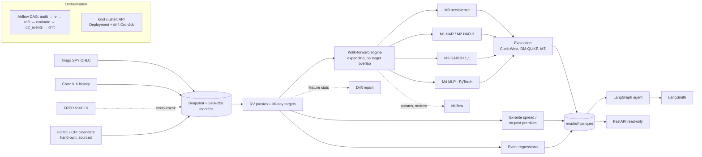
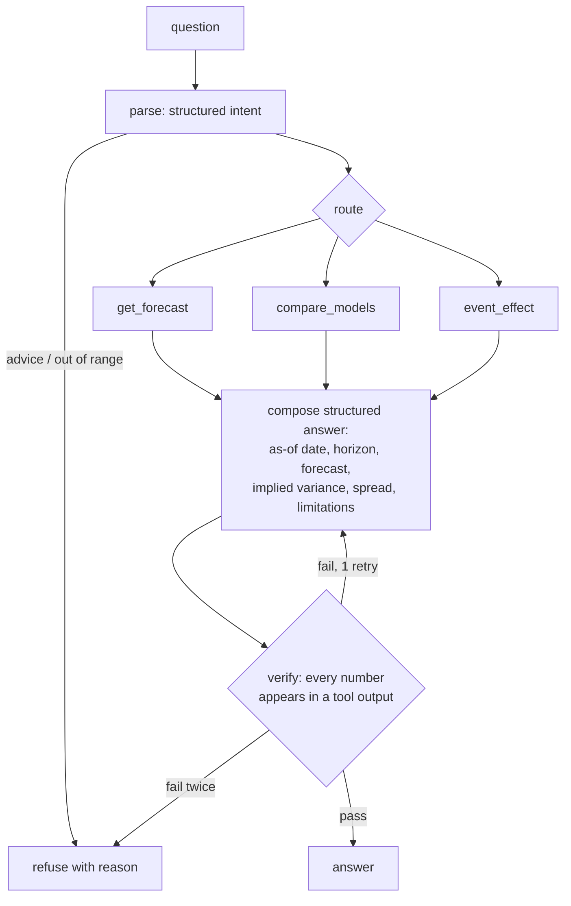

# vol-forecast-lab — build guide (S1)

**Date started:** _YYYY-MM-DD_
**Starting point:** empty repo. Reused: the snapshot-and-hash data discipline and the
pre-registration / deviations pattern from `tsmom-panel-study`.
**Goal:** a research tool that answers three pre-registered questions on S&P 500 ETF daily data —
(1) does VIX-implied variance improve out-of-sample forecasts of the next 30 days' realised
variance beyond HAR (with GARCH, a persistence baseline and a small MLP as comparators);
(2) how implied variance compares with the forecast (estimated ex-ante spread) and with what
followed (ex-post premium); (3) whether scheduled CPI and FOMC days carry extra variance, overnight
or in the session — delivered as a reproducible pipeline with experiment tracking, data versioning,
drift monitoring, Docker, CI, an Airflow DAG, a local Kubernetes deployment, and a tool-calling
agent that only reports computed numbers.
**Labels:** public data; research prototype; not investment advice. Not a trading system.

**Authorship rule.** The author hand-writes the core: RV proxies, targets, splitter, HAR/HAR-X,
losses and tests (Clark–West, Diebold–Mariano, Mincer–Zarnowitz), event regressions, the MLP,
the agent graph and verifier, the DAG task graph, the Kubernetes manifests, drift metrics and every
test. AI assistance is limited to plumbing (data fetch, Docker/Compose files, CI workflow, FastAPI
wrapper, README formatting), reviewed line by line. Each step says which applies.

**Build order (vertical slice first).** Lock data and pre-registration → persistence/HAR/HAR-X
with evaluation → GARCH and the event study → MLP and agent → MLOps, Airflow and Kubernetes →
write-up. JAX is a stretch item after everything else. Hours are ESTIMATES (~35 h core).

---

## Architecture





---

## Repository layout

```
vol-forecast-lab/
  README.md  BUILD_GUIDE.md  FINDINGS.md  CASE_STUDY.md  LICENSE
  prereg/PREREGISTRATION.md  prereg/DEVIATIONS.md
  data/SOURCES.md  data/snapshot_manifest.json  data/audit.json
  data/events/fomc.csv  data/events/cpi.csv  data/events/unscheduled.csv
  data/raw/  data/snapshots/                 # git-ignored
  src/volab/ data.py  calendar.py  rv.py  targets.py  splits.py  losses.py  stats_tests.py
             models/{baselines,har,garch,mlp}.py  spread.py  events.py  drift.py
  agent/ graph.py  tools.py  schemas.py  eval_questions.yaml  run_eval.py
  api/app.py   dags/vol_pipeline.py   k8s/   docker-compose.airflow.yml
  scripts/ fetch_data.py  audit_snapshot.py  run_all.py
  tests/  fixtures/   results/  figures/
  Dockerfile  .github/workflows/ci.yml  requirements.txt  .gitignore  .env.example
```

---

## Step 0 — Repo and environment (0.5 h)

**What.** Repo, `.venv`, pinned `requirements.txt` (pandas, numpy, scipy, statsmodels, arch, torch,
exchange-calendars, pyarrow, mlflow, langgraph, langchain-openai, langsmith, pydantic, fastapi,
uvicorn, pytest). `.gitignore`: `.env`, `.venv`, `data/raw`, `data/snapshots`, `mlruns`, `*.db`.
MIT licence. `prereg/DEVIATIONS.md` header.
**Who.** AI-drafted plumbing, reviewed.
**Result.** `python -m pytest` runs. Actual: _fill_.
**Committed.** _hash_

## Step 1 — Data pull, snapshot, audit (2 h)

**What.** `fetch_data.py` pulls SPY adjusted OHLC and VIX once into `data/snapshots/<id>/`, hashes
each file, writes the manifest, never overwrites. `audit_snapshot.py` runs PREREGISTRATION §2.4
and writes `data/audit.json`, including the list of dates excluded under §2.3 (no forward-fill).
**Who.** Fetch = AI-drafted. Audit rules = author.
**Result.** _sessions, violations, VIX mismatches, excluded dates_.
**Committed.** _hash_

## Step 2 — Event calendars (1 h)

**What.** `fomc.csv`, `cpi.csv`, `unscheduled.csv`: `date, time_et, type, source_url`.
**Who.** Author (Gemini may draft the list; every row checked against its source page).
**Tests.** Every date is a session; every row has a URL; CPI rows are 08:30 ET; FOMC rows fall
inside the regular session; same-day CPI+FOMC dates listed.
**Committed.** _hash_

## Step 3 — RV proxies and 30-day targets (2 h)

**What.** `rv.py`: `overnight`, `session_return`, `garman_klass`, `parkinson`, `rv_primary`,
`cross_term`. `targets.py`: `target_30d(rv, sessions, t)` and `n_sessions(t)` per §3.2.
**Who.** Author.
**Tests (hand-computed).**

| Case | Inputs | Expected |
|---|---|---|
| Day 1, no gap | C_prev 100, O 100, H 102, L 99, C 101 | r_on = 0; GK = 0.000407353; RV = 0.000407353 |
| Day 2, gap up | C_prev 101, O 101.5, H 102, L 100.5, C 100.8 | r_on² = 0.0000243866; GK = 0.0000912428; RV = 0.000115629 |
| Parkinson, day 1 | H 102, L 99 | 0.000321432 |
| 30-day window | t = 2 Jan; sessions 30 Jan, 1 Feb, 2 Feb | includes 30 Jan and 1 Feb (= t + 30 days); excludes 2 Feb; N_t = 2 |
| Excluded session inside window | one session flagged missing | target dropped, logged |
| Zero-range day | O=H=L=C | GK = 0, not NaN |

**Committed.** _hash_

## Step 4 — Freeze the pre-registration (1 h)

**What.** Fill every placeholder (hashes, counts, seeds, versions, audit table, F_min, regime
thresholds — the last two from the training window only). Commit, `git tag v0.1-prereg`, push the
tag. Optional OSF registration.
**Rule.** No model fitted and no test-period number looked at before this commit.
**Committed.** _hash_ / tag _hash_

## Step 5 — Walk-forward splitter (1.5 h)

**What.** `splits.py`: expanding windows, refit every 21 sessions, and the rule that the last
training target ends before the forecast date.
**Who.** Author.
**Tests.** No training target overlaps a forecast date; windows never shrink; first forecast =
first session ≥ test start; validation rows never used to fit M1–M3 parameters used in test.
**Committed.** _hash_

## Step 6 — Vertical slice: M0, HAR, HAR-X (2 h)

**What.** `baselines.py` (M0; R1 implied), `har.py` (OLS with `numpy.linalg.lstsq`; M2 adds
IV_t/N_t); per-session forecasts × N_t; positivity rule §3.4 with floor counts.
**Who.** Author.
**Tests.** HAR recovers β = [0.1, 0.4, 0.3, 0.2] to 1e-8 on noise-free synthetic data; IV for
VIX = 20 equals 0.00328767; HAR-X with a zero IV coefficient reproduces HAR exactly.
**Committed.** _hash_

## Step 7 — Evaluation (3 h)

**What.** `losses.py` (QLIKE, MSE); `stats_tests.py`: Clark–West, Diebold–Mariano, Mincer–Zarnowitz,
Newey–West HAC, Holm. Run M0/M1/M2 end to end on the test period; write `results/*.parquet`.
This completes the slice: data → targets → models → Q1 result.
**Who.** Author. Cross-check: DM t-stat equals statsmodels OLS of d_t on a constant with
`cov_type="HAC"` and the same lag (to 1e-6).
**Tests.** QLIKE(RV = F) = 0; QLIKE(RV = 2F) = 0.306853; QLIKE(RV = F/2) = 0.193147;
DM and Clark–West on identical forecasts → statistic 0; planted-leak test (§9.1) shows a sharp drop.
**Committed.** _hash_

## Step 8 — GARCH(1,1) (1.5 h)

**What.** `garch.py`: `arch` normal QMLE on % returns; sum N_t step-ahead variances; ÷ 10,000.
**Tests.** Unit conversion; forecast positive; parameters within stationarity (α + β < 1) logged.
**Committed.** _hash_

## Step 9 — Spread, premium and event study (3 h)

**What.** `spread.py`: ex-ante spread (IV − HAR forecast) and ex-post premium (IV − realised),
summaries by year and regime. `events.py`: the §7.3 regressions per component, §7.4 VIX-change
regression, Holm, counts and CIs, robustness runs.
**Who.** Author.
**Tests.** Regression recovers a planted event effect on a synthetic series; an event date off the
calendar raises; same-day CPI+FOMC sets both indicators.
**Committed.** _hash_

## Step 10 — MLP challenger (3 h)

**What.** `mlp.py` per PREREGISTRATION §4.3: scaler fitted on training rows only, three seeds,
validation-only selection, annual re-train, results reported whatever they show.
**Tests.** Scaler uses training rows only (assert); fixed seed → identical output; shuffled-target
MLP loses to M0.
**Committed.** _hash_

## Step 11 — Research agent: LangGraph + LangSmith (4 h)

**What.** Tools read only `results/*.parquet`: `get_forecast(as_of, model)`, `compare_models(start,
end, metric)`, `event_effect(event, component)`. Pydantic answer schema: as-of date, horizon,
forecast, implied variance, spread, limitations, `source_rows[]`. Verifier node rejects any number
not present in a tool output. Refuses advice and out-of-range dates. LangSmith tracing; model
pinned in `.env`; per-run cost cap in code.
**Who.** Author: graph, nodes, verifier, scorer. AI-drafted: LangSmith setup lines.
**Evaluation.** 15 questions with expected answers written **before** the first run: 10 look-ups,
3 comparisons, 2 refusals. Exact match to stated rounding, correct tool, refusal accuracy, cost and
latency. Three repeats, each reported separately.
**Committed.** _hash_

## Step 12 — MLOps (2.5 h)

**What.** MLflow (local) for every fit; snapshot ID recorded in every results table; `drift.py`:
monthly PSI of HAR inputs vs training (> 0.25 = drift) and rolling 63-session QLIKE ratio
M2/M1 (> 1.10 for 3 consecutive months = degradation); Dockerfile; GitHub Actions: lint, pytest and
a pipeline smoke run on the synthetic fixture.
**Who.** Drift metrics = author. Dockerfile, CI = AI-drafted, reviewed.
**Committed.** _hash_

## Step 13 — Airflow DAG and local Kubernetes (5.5 h) — must-have

**What.**
- **Airflow** (official Docker Compose, pinned): `dags/vol_pipeline.py` with
  `audit_snapshot → build_rv → refit_models → evaluate → q2_events → drift_report`, calling
  `run_all.py` stages. Fixture by default; `use_snapshot` param for local data. Retries = 1; a failed
  audit stops every downstream task.
- **Kubernetes** (`kind`): image from the Step 12 Dockerfile loaded into kind; `k8s/` manifests for a
  `Deployment` + `Service` serving the read-only FastAPI endpoint (`/forecast`, `/compare`,
  `/health`) with readiness/liveness probes and resource requests/limits; a `CronJob` for the monthly
  drift report; a `ConfigMap` for paths and thresholds. No secrets in manifests.
- CI adds a DAG import test and `kubectl apply --dry-run=client` on the manifests.
**Who.** Author: DAG graph and failure rules, manifests, tests. AI-drafted: Compose file, FastAPI wrapper.
**Tests.** DAG has exactly six tasks in order; failed audit → downstream `upstream_failed`;
`/health` returns 200 in kind; `kubectl create job --from=cronjob/...` writes a drift report.
**Boundary (README).** Local orchestration and a local cluster; not a production deployment.
**Committed.** _hash_

## Step 14 — Write-up and release (3 h)

**What.** `FINDINGS.md` (every pre-registered result, misses first-class, deviations referenced);
`CASE_STUDY.md` (one page); README (provenance, definitions, assumptions, quickstart on the fixture,
how to reproduce the headline, boundary statement, diagrams). Four charts: forecast comparison;
calibration / errors over time; implied vs realised spread; event variance split. Summary numbers:
test size, HAR-X incremental result, calibration, mean ex-post premium, event estimates with CIs.
**Definition of done before public.** Clean clone → fresh venv → install, tests, quickstart;
all-commit history scan; `git log --all --oneline -- .env` empty; tracked-file check; independent
review; About + topics; MIT. Optional short recording (title card on the first frame).
**Committed.** _hash_ — then public.

## Stretch — JAX (1.5 h, only after Step 14)

Batched GARCH(1,1) log-likelihood and gradient in JAX; compare with `arch` on the same windows.
Report measured hardware, warm-up/compile time and run time. No speed-up or tolerance promised in
advance.

---

## Scorecard (fill at the end)

| Item | Target | Actual |
|---|---|---|
| Pre-registration tagged before first fit | yes | |
| Tests passing | all | _n_ |
| Q1 (Clark–West) | pre-committed reading applied | |
| Leakage checks | all pass | |
| Agent eval, 3 runs | reported separately | |
| DAG run + kind deployment | working | |
| Deviations logged | every one | _n_ |
| Clean-clone test | pass | |

## Issues and fixes

| # | Issue | Cause | Fix | Commit |
|---|---|---|---|---|
| 1 | | | | |

## Lessons

_fill_

## Next

- Intraday bars: announcement-window event study and intraday realised variance.
- Options-chain data: implied-volatility surface, skew and term structure.
- Managed deployment of the DAG and services on a cloud cluster.
