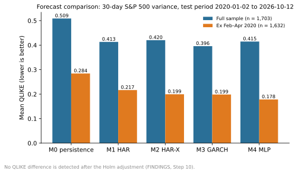

# vol-forecast-lab

**Does VIX-implied variance add anything to a HAR forecast of the next 30 days' S&P 500 variance — and
can the answer, and the FOMC text behind it, be served by a platform that proves every number?**

A pre-registered walk-forward forecasting study (persistence, HAR, HAR-X, GARCH(1,1), MLP) plus the
data and AI platform around it: an FOMC document pipeline through Kafka, an AWS serverless lake,
Spark, hybrid OpenSearch + Qdrant search and a Redis cache; a LangGraph agent that may only repeat
computed numbers; MLflow, drift monitoring, an Airflow DAG and a local Kubernetes (kind) deployment.

Research prototype on public data. Not investment advice; not a trading system.

## Headline results

| Question | Result | Where |
|---|---|---|
| Q1 — does HAR-X beat HAR? (Clark–West, the only headline test) | **Detected outside Feb–Apr 2020**: t = 3.14, one-sided p = 0.0009, n = 1,632. Not detected on the full sample (p = 0.0597). The window rule was fixed before any ex-window number existed and after the full-sample result (p = 0.0597) was known. | [FINDINGS](FINDINGS.md) Step 7 |
| Q1b–Q1d — QLIKE comparisons (HAR-X v HAR, MLP v HAR-X, HAR v GARCH, HAR v persistence) | None detected after the pre-registered Holm adjustment, in either sample | FINDINGS Step 10 |
| Q2 — implied vs realised | Ex-ante spread positive (t = 7.80); ex-post premium positive outside spring 2020 (t = 7.05), not detected on the full sample | FINDINGS Step 9 |
| Q3 — event days | CPI overnight variance +37% (95% CI +4% to +80%); FOMC session variance +84% (+30% to +160%) | FINDINGS Step 9 |
| Retrieval (15 frozen questions) | Fused BM25 + dense recall@5 0.589 vs dense 0.389; cloud path equal to local (266/266 documents, 6,620/6,620 chunks) | FINDINGS 10b–10c |
| Agent (15 frozen questions × 3) | 0.844 (38/45); no unverified number in any answer; USD 0.064 in total | FINDINGS Step 11 |
| Agent v2 – supervisor + 3 sub-agents + memory (12 pre-registered questions × 3) | 20/36; routing 46/51; memory follow-ups 9/15; refusals 6/6; no unverified number in any answer; USD 0.0023 per turn | FINDINGS Agent v2 |

Misses are reported as results: hybrid retrieval lost to dense in Step 10b; the MLP did not beat
HAR-X; the PSI drift rule cannot separate drift from regime variation; two agent-verifier limits are
open. Every claim, its file, its reproduce command and its commit: [EVIDENCE.md](EVIDENCE.md).



## Read next

| Document | What it holds |
|---|---|
| [FINDINGS.md](FINDINGS.md) | Every pre-registered result, misses first-class, deviations referenced |
| [docs/case-study.md](docs/case-study.md) | One-page case study: problem, decisions, controls, results, what failed |
| [EVIDENCE.md](EVIDENCE.md) | Claim → value → file → command → commit (31 claims) and the boundaries |
| [ARCHITECTURE.md](ARCHITECTURE.md) | Layers, code paths, data flows, controls, deployment view |
| [docs/adr/](docs/adr/README.md) | Ten architecture decision records |
| [prereg/PREREGISTRATION.md](prereg/PREREGISTRATION.md), [DEVIATIONS.md](prereg/DEVIATIONS.md) | The design frozen before any fit (tag `v0.1-prereg`), and every dated change since |
| [BUILD_GUIDE.md](BUILD_GUIDE.md) | Step-by-step build, who wrote what, issues and fixes, scorecard |

## Diagrams and charts

- Research pipeline: [`figures/diagrams/overall.svg`](figures/diagrams/overall.svg)
- Platform: [`platform.svg`](figures/diagrams/platform.svg) · document pipeline [`step10b.svg`](figures/diagrams/step10b.svg) · platform slice [`step10c.svg`](figures/diagrams/step10c.svg) · deployment [`deployment.svg`](figures/diagrams/deployment.svg) · event-driven registry [`eventdriven.svg`](figures/diagrams/eventdriven.svg)
- Charts (aggregates only): [forecast comparison](figures/results/fig1_forecast_comparison.svg) ·
  [errors over time](figures/results/fig2_errors_over_time.svg) ·
  [implied vs realised by year](figures/results/fig3_spread_premium_by_year.svg) ·
  [event variance split](figures/results/fig4_event_variance_split.svg)

## Provenance

| Input | Source | Pinned as |
|---|---|---|
| SPY daily adjusted OHLC | Tiingo | snapshot `20261112T071104Z`, SHA-256 per file in `data/snapshot_manifest.json` |
| VIX daily close | Cboe (FRED VIXCLS cross-check) | same snapshot |
| FOMC and CPI calendars | federalreserve.gov, bls.gov — one source URL per row | `data/events/*.csv`, hashes in the pre-registration |
| FOMC statements (HTML) and minutes (PDF) | federalreserve.gov | `results/text/text_manifest.json`; extractor version 1.2 |
| Embeddings, agent model | OpenAI `text-embedding-3-small`; `gpt-5.4-mini-2026-03-17` | `.env.example`, `results/agent/agent_eval_summary.json` |

The audit (`scripts/audit_snapshot.py`) runs before anything else: 4,241 sessions, 0 missing, 0 OHLC
violations, 0 VIX mismatches, 67/67 ex-dividend checks, 33 VIX non-session rows excluded (no
forward-fill).

## Definitions

- **Realised variance (RV)** — daily: squared overnight return plus the Garman–Klass session
  estimate; the 30-day target is the sum over sessions in (t, t + 30 calendar days].
- **M0–M4** — M0 persistence; M1 HAR (daily, weekly, monthly RV); M2 HAR-X (M1 + VIX-implied
  variance known at t); M3 GARCH(1,1); M4 MLP on M2's inputs.
- **QLIKE** — RV/F − log(RV/F) − 1; ranks forecasts correctly under a noisy, unbiased proxy.
- **Clark–West** — out-of-sample test for nested models (M2 nests M1); one-sided.
- **Ex-window** — drops the 71 forecasts whose date or 30-day target touches 15 Feb – 30 Apr 2020
  (rule in DEVIATIONS, fixed before any ex-window number).
- **Spread / premium** — VIX-implied 30-day variance minus the HAR forecast (ex-ante) / minus
  realised (ex-post).

## Assumptions

SPY stands in for the S&P 500 index; daily data only (event effects cover the whole session, not the
announcement window); VIX level only, no options chain; 24 pre-2013 FOMC times assume 14:15 ET
(`data/events/GAPS.md`). Full list: PREREGISTRATION §0 and §2.

## Quickstart (synthetic fixture, no keys, no market data)

Python 3.12 or 3.14.

```bash
python -m venv .venv
source .venv/bin/activate            # Windows: .venv\Scripts\Activate.ps1
python -m pip install torch==2.15.0 --index-url https://download.pytorch.org/whl/cpu
python -m pip install -r requirements-dev.txt
python -m pytest -q -m "not airflow"  # Docker / Spark tests skip when the service is absent
python scripts/smoke_run.py           # audit + panel build on fixtures/synthetic
python scripts/make_charts.py         # rebuilds figures/results/ from committed aggregates
```

The first test run downloads the tiktoken `cl100k_base` encoding (network needed once).
Platform services: `docker compose -f docker-compose.platform.yml --profile kafka --profile search --profile cache up -d`.
Airflow: `docker-compose.airflow.yml`; kind: `scripts/kind_up.ps1` (see `docs/step13_evidence.md`).

## Reproducing the headline

The price data licence does not allow redistribution, so the snapshot is not in the repo (ADR 0003).
With your own Tiingo key in `.env` (see `.env.example`):

The `/forecast` endpoint and the agent also require the git-ignored `results/forecasts.parquet` series; M4 lookups additionally use `results/mlp_forecasts.parquet`.

```bash
python scripts/fetch_data.py         # writes a new snapshot; to match, it must reproduce the hashes in PREREGISTRATION.md
python scripts/audit_snapshot.py
python scripts/build_panel.py
python scripts/run_eval.py           # Q1, Q1b, Q1d  → results/tests*.parquet
python scripts/run_q2_q3.py          # Q2, Q3, window rule
python scripts/run_mlp.py && python scripts/run_holm.py   # Q1c and the final Holm family
```

A vendor revision changes the hashes; the audit then fails rather than producing different numbers
silently. The committed result files and `EVIDENCE.md` let a reviewer check every number without
re-running.

## Boundaries

- Local orchestration and a local cluster; not a production deployment. The full snapshot DAG run
  (`use_snapshot=true`) has not been executed.
- AWS resources existed only for the 16 Nov 2026 evidence run and were destroyed the same day.
- Retrieval and agent evals have 15 questions each: directional evidence, not benchmarks.
- No signal, threshold or trade rule is drawn from any result.
- Public outputs carry statistics and aggregates only — no price, return, realised-variance or
  forecast series.

## Who did what

Design, pre-registration, research code, decisions and every review: Kakali Bandyopadhyay.
Infrastructure scaffolding, test harnesses and plumbing were drafted with AI coding assistants from
written briefs and reviewed before commit; the split per step is in BUILD_GUIDE.md ("Who").

## Licence

Code: [MIT](LICENSE). Data are not included; FOMC documents are U.S. government works.

