# From central-bank documents to governed hybrid search: an evidence-gated data and AI platform

**Tags:** Data · AI · Architecture case study
**Status (17 Nov 2026):** Steps 1–13 complete and measured; Step 14 write-up in this revision. The Step 10c AWS lake run was completed, evidenced and destroyed on 16 Nov 2026. Every number below comes from committed output files; claim-by-claim checks in `EVIDENCE.md`.
**Code:** vol-forecast-lab · **Diagrams:** `figures/diagrams/platform.svg`, `step10b.svg`, `step10c.svg`

---

## The problem

Rates and volatility desks read every FOMC statement and set of minutes, but the text sits in PDFs and HTML pages that no system can query by meeting, by date or by who dissented. I wanted one pipeline that turns those documents into searchable, auditable data — and that I could prove behaves the same way every time it runs, at a known cost.

The same repository holds a pre-registered realised-volatility forecasting study (HAR-X vs HAR, Clark–West test). Its headline: VIX-implied variance adds information beyond HAR outside Feb–Apr 2020 (Clark–West p = 0.0009), not detected on the full sample (p = 0.0597) — see `FINDINGS.md`. The document pipeline is kept separate from the models by design: retrieval and citation only, no text features.

## What I built

1. **Unstructured-data pipeline (Step 10b, done).** Fetch → extract → chunk → data-quality checks → index → evaluate, each stage writing Parquet with a fixed schema.
   - Corpus: **134 statements and 132 minutes = 266 documents → 6,620 chunks, 1.50M tokens.**
   - Index: Qdrant with dense embeddings (text-embedding-3-small) plus a keyword vector with server-side IDF, fused with reciprocal rank fusion (RRF). Each chunk carries a contextual header (document type + meeting date).
   - Idempotent: a full re-run upserts **6,620, then 0**.
2. **Platform slice (Step 10c, done; AWS run 16 Nov 2026, destroyed the same day).**
   - **Kafka** topics `docs.raw`, `docs.clean`, `docs.dlq`: idempotent producer (`acks=all`), manual commits, three attempts then dead-letter queue.
   - **AWS serverless lake** via Terraform: S3 `raw/ → clean/ → curated/`, an extraction Lambda shipped as a container image from ECR, Glue table with partition projection, Athena workgroup with a 100 MB scan cutoff.
   - **PySpark** compaction and statistics, checked against pandas.
   - **OpenSearch** BM25 fused with Qdrant dense results (RRF, k = 60), rerun on the same frozen questions.
   - **Redis** search cache and per-client token-bucket rate limiter behind the API.
3. **Research agent (Step 11).** LangGraph graph whose tools read only computed result files; a copy-only verifier rejects any number not present in a tool output; refuses advice and out-of-range dates; pinned model and a per-run cost cap.
4. **MLOps (Step 12).** MLflow tracking, snapshot ID on every results table, monthly drift report (PSI on model inputs, QLIKE ratio for degradation).
5. **Runtime and delivery (Step 13).** FastAPI service in Docker (`/search`, `/forecast`, `/compare`, `/health`, `/metrics`); Airflow 3.4 for orchestration; a local Kubernetes (kind) cluster; CI running tests on Python 3.12 and 3.14, Terraform validate, Docker build, DAG import and manifest validation. Package versions and service images are pinned; the Lambda base image uses the AWS Python 3.12 tag and is not pinned by digest.

## Architecture

Documents enter once, are published as events, land raw in S3, are extracted by the Lambda into a typed clean layer, are queryable in Athena, compacted by Spark, and indexed into two search engines whose results are fused before the API serves them. Every hop is idempotent and every layer is checked against the one before it.

## Eight decisions and why

| # | Decision | Alternative rejected | Why |
|---|---|---|---|
| 1 | Hybrid retrieval (dense + keyword, RRF) with a contextual header | Dense only | Central-bank text turns on exact terms ("dissent", named members) that embeddings blur |
| 2 | Evaluation questions written and labels frozen **before** any embedding | Tune questions after seeing results | Stops me grading my own homework; post-hoc diagnostics are labelled as such |
| 3 | Kafka with idempotent producer, manual commit, DLQ; at-least-once delivery plus consumer dedupe on (doc_id, sha256) | Exactly-once transactions | Simpler to operate; duplicates are made harmless instead of impossible |
| 4 | Lambda as a container image | Zip + layers | PyMuPDF and pyarrow exceed the 250 MB unzipped limit |
| 5 | Athena partition projection | Glue crawlers | No crawler runs, no schema drift, predictable partitions |
| 6 | Paragraph arrays stored in the lake + a chunk-parity gate | Re-chunk from flat text | Guarantees the cloud path produces the same 6,620 chunks as the local path |
| 7 | Clean-layer publisher reads S3 metadata and a checkpoint | Read every Parquet file | Cheaper, restart-safe, no extra IAM read on content |
| 8 | Budget stack applied separately and never destroyed; same-day teardown of everything else | One Terraform root | The cost alarm must outlive the infrastructure it watches |

## Controls built in

| Requirement | Control | Evidence |
|---|---|---|
| Cost | USD 10 budget with 50/80/100% alerts; Athena 100 MB scan cutoff; destroy the same day | budget plan; `10c_athena.json` bytes scanned; `10c_destroy.txt` |
| Security | Lambda role limited to reading `raw/*`, writing `clean/*` and its own log group; build user scoped to one ECR repository; ECR scan on push; no secrets in git (history check in every commit routine) | Terraform plan; IAM policy files |
| Reliability | Idempotent writes at every hop; retries then DLQ; replay test proves a message delivered twice is indexed once | `tests/test_kafka.py`; `10c_kafka.json` counters |
| Data quality | DQ flags per document; lake text must equal the local text for every document; chunk parity row for row | DQ report; `10c_evidence.json` |
| Reproducibility | Pinned data snapshot, model snapshot, package and image versions; CI on every push | CI history |

## Results (measured)

**Step 10b retrieval — 15 pre-registered questions, no filters**

| Mode | Recall@5 | MRR@10 | Statements recall@5 | Minutes recall@5 |
|---|---|---|---|---|
| Dense | 0.389 | 0.286 | 0.250 | 0.548 |
| Hybrid (RRF) | 0.322 | 0.244 | 0.125 | 0.548 |
| Keyword | 0.122 | 0.130 | 0.000 | 0.262 |

**Step 10c platform — AWS run 16 Nov 2026** (from `results/text/10c_*.json`)

| Check | Result |
|---|---|
| Kafka: 266 published; indexer processed 266, DLQ 0; replay of all 266 → 266 duplicates suppressed, 0 re-uploaded | PASS |
| Lambda invocations / errors | 266 / 0 |
| Athena: 134 statements / 132 minutes across 34 partitions; 2020 statements = 7 rows; ≤ 20,748 bytes scanned per query (billed at the 10 MB minimum) | PASS |
| Text parity (266/266 identical) and chunk parity (6,620 rebuilt = 6,620 stored, row for row) | PASS |
| Recall@5 on the same 15 frozen questions: OpenSearch BM25 / dense / fused | 0.367 / 0.389 / **0.589** (MRR@10 0.288 / 0.286 / 0.402) |
| Redis cache and limiter | miss 4,013 ms → hit 37 ms; hit rate 0.917; burst of 15 → 10 allowed, 5 × 429 |
| Spark compaction vs pandas | 34/34 groups equal |

**Step 11 agent — 15 pre-registered questions × 3 repeats:** accuracy 0.844 (38/45); tool choice 45/45; refusals 6/6; no unverified number reached an answer; USD 0.064 in total, p50 4.1 s.

## What failed, and why

- **Hybrid did not beat dense.** On statement questions hybrid scored 0.125 against dense 0.250. A post-hoc check (labelled, gold labels unchanged) found a same-meeting chunk naming the answer in the hybrid top five for **6 of 8** statement questions (dense 5 of 8). The gold sets were labelled within one document type, while the same fact often appears in both the statement and the minutes. Lesson: label gold sets across document types.
- **A per-document index call would have erased the index.** The indexing function deletes points it no longer sees, which is correct for a full batch and destructive when a consumer calls it one document at a time. Caught in review before any run; fixed with an explicit flag and a two-document test.
- **Test doubles that lie.** A fake S3 returned a field the real listing API never returns, so a checkpoint test passed against behaviour production would not have. Fixed by making fakes match the real API.
- **A policy that can create cannot always destroy.** Teardown stopped on the Glue database: deleting it also needs permission on its user-defined functions. Fixed the build user's policy, finished the destroy, and kept both attempts in `10c_destroy.txt`.
- **Two Windows-specific traps in the image push.** PowerShell re-encodes piped passwords (ECR login 400), and Docker Desktop pushes an image index with attestations that Lambda rejects. Both fixed in the build script.
- **The verifier checks presence, not meaning.** Two answers reported a log-scale coefficient instead of the effect (both numbers were in the tool output), and p-value rounding was enforced only by the prompt. Left open: fixing and re-running the same questions would be tuning on the test set.
- **A drift rule that always fires.** PSI on 126-session windows flags most month-ends even inside the training period, so for persistent inputs it cannot separate drift from regime change. Reported as a limit, not tuned.
- **Known data gap.** The 24 Oct 2012 minutes exist only as HTML in the source; recorded as a known gap rather than patched.

## What changes at bank scale

| Here | In a bank |
|---|---|
| Local Kafka | Managed Kafka (MSK) with a schema registry and data contracts per topic |
| Local Spark container | Glue jobs or EMR with job bookmarks |
| Local OpenSearch, Redis | OpenSearch Service, ElastiCache, both in private subnets |
| IAM user with inline policies | SSO roles, permission boundaries, Lake Formation column-level access |
| Public documents | PII classification and masking at the clean layer; retention rules |
| Frozen eval set | Model-risk review: versioned eval sets, approval before a retrieval change ships, drift monitoring |

## Who did what

Design, decisions, author code (extraction, chunking, indexing, Kafka producer and consumers, evaluation) and every review: me. Infrastructure scaffolding and test harnesses were generated with AI coding assistants from written briefs and reviewed line by line before commit.

## Next

Label retrieval gold sets across document types (new, separately committed set); a field-aware agent verifier tested on new held-out questions; a block-bootstrap null for the PSI threshold; intraday data for announcement-window effects; a managed deployment of the DAG and services.
